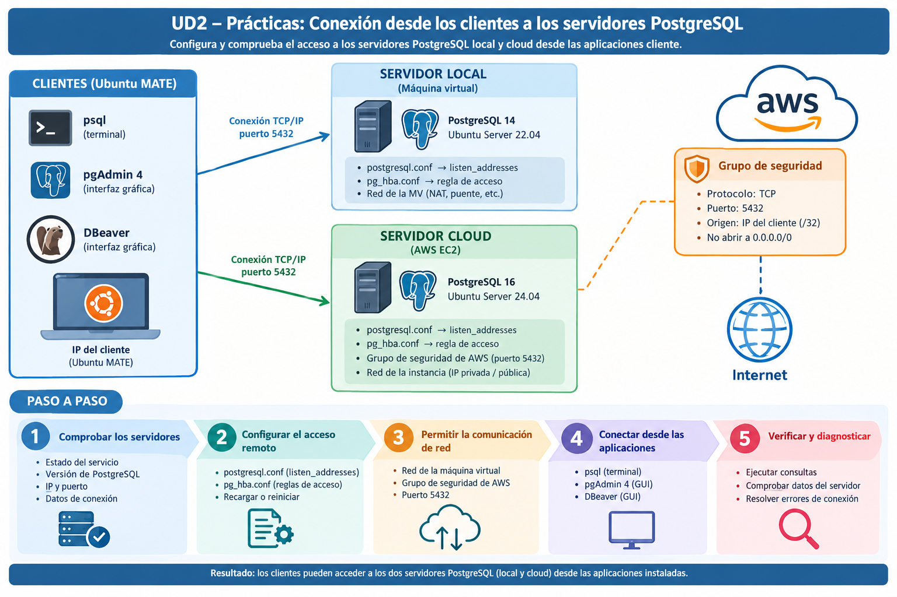

# Actividad práctica: configuración y conexiones de PostgreSQL

En estas actividades trabajarás con las máquinas virtuales preparadas en la unidad anterior. Desde un equipo cliente con Ubuntu MATE, configurarás y comprobarás la conexión a dos servidores PostgreSQL: uno instalado en una máquina virtual local y otro desplegado en una instancia de AWS EC2.

Antes de modificar la configuración de un servidor, realiza una copia de seguridad de los archivos que vayas a cambiar. 

Al finalizar cada actividad, recoge las evidencias solicitadas y explica brevemente los resultados obtenidos.

**Entorno y datos necesarios**

## Actividad 1. Preparación de la base de datos de prácticas en los servidores

En esta actividad se configurará un entorno de pruebas en los servidores PostgreSQL local y cloud. Para ello, se creará la base de datos geográfica `geo` junto con el rol de acceso `geo`, que se utilizarán en las prácticas posteriores.

**Tareas**

1. **Descargar el fichero SQL de la práctica.** Descarga el archivo `dades_geo.sql`, que contiene los datos geográficos de `geo` y las instrucciones necesarias para crear el rol `geo`.
    - Utiliza el comando `wget https://pastebin.com/raw/UexT4J4w -O dades_geo.sql` 
2. **Preparar el entorno de pruebas.** Prepara con ese fichero el entorno de prácticas tanto en el servidor PostgreSQL local como en el servidor cloud.
    - Accede a una sesión de `psql`.
    - Importa el contenido del archivo `dades_geo.sql` en cada servidor.
3. **Comprobar la creación de los objetos.** Comprueba que en cada servidor la importación se ha realizado correctamente y están disponibles la base de datos `geo`, las tablas de ejemplo incluidas en el script y el rol de acceso `geo`.
    - Utiliza metacomandos de `psql` para consultar el catálogo de bases de datos, roles y tablas.
4. **Verificar la conexión con el rol `geo`.** Comprueba que este rol puede conectarse localmente a la base de datos correspondiente.
    - Inicia una sesión de `psql` utilizando el usuario `geo`.
    - Accede a la base de datos `geo` y verifica que puedes consultar sus tablas.
    
**Evidencias**

- Identificación de la base de datos y el rol.
- Inventario de las tablas de ejemplo disponibles.
- Resultado de una conexión local con el rol `geo`.
- Comandos psql utilizados en las diferentes tareas.

!!! info "Resultado esperado"

    Al finalizar la actividad, ambos servidores PostgreSQL deberán disponer de una base de datos denominada geo, con sus tablas de ejemplo correctamente cargadas y accesibles mediante el rol geo, que deberá poder establecer conexión y realizar consultas básicas sobre la base de datos.

**Entrega**

Elabora un documento con los procedimientos realizados, los comandos utilizados, las explicaciones necesarias y las capturas de pantalla que demuestren los resultados.

## Actividad 2. Configuración del acceso remoto al servidor PostgreSQL local

En esta actividad habilitarás el acceso remoto a la instancia PostgreSQL instalada en la máquina virtual local. Configurarás el servidor para que el rol `geo` pueda conectarse a la base de datos `geo` desde cualquier equipo de la red local.

**Tareas**

1. **Configurar PostgreSQL para aceptar conexiones remotas (la escucha del servidor).** Modifica la configuración del servidor PostgreSQL para permitir conexiones desde el equipo cliente mediante el archivo `postgresql.conf`.
    - Revisa los parámetros relacionados con las interfaces de escucha del servidor.
    - Reinicia el servicio si es necesario para aplicar los cambios.
2. **Configurar las reglas de autenticación.** Adapta la configuración para permitir que el rol `geo` se conecte a la base de datos `geo` desde cualquier IP de la red local.
    - Autoriza únicamente la base de datos `geo` y el rol `geo`.
    - Limita el origen a las direcciones de la red local.
3. **Verificar el acceso remoto mediante psql.** Desde el cliente Ubuntu MATE, establece una conexión remota utilizando exclusivamente la herramienta `psql`.
    - Conéctate a la base de datos `geo` utilizando el rol `geo`.
    - Ejecuta consultas que permita identificar el servidor al que se ha realizado la conexión.
    - Comprueba que la conexión se realiza correctamente desde el cliente y que el acceso queda limitado a la red local.
    - Si la conexión falla, identifica si el problema está relacionado con la red, la escucha del servidor, las reglas de autenticación o las credenciales.

**Evidencias**

- Valores de configuración relevantes
- Regla de acceso aplicada, indicando la red autorizada y el método de autenticación.
- Comandos psql utilizados para realizar la conexión remota desde cliente.
- Resultado de una conexión remota satisfactoria 
- Resultado de una consulta de identificación del servidor (por ejemplo, versión, dirección o nombre del servidor).

!!! info "Resultado esperado"

    Al finalizar la actividad, los equipos de la red local deberán poder conectarse al servidor PostgreSQL utilizando el rol `geo` y acceder a la base de datos `geo`; las conexiones desde fuera de esa red no deberán estar autorizadas por esta regla.

**Entrega**

Elabora un documento con los procedimientos realizados, los comandos utilizados, las explicaciones necesarias y las capturas de pantalla que demuestren los resultados.

## Actividad 3. Acceso remoto al servidor cloud

En esta actividad configurarás el acceso remoto a una instancia PostgreSQL desplegada en AWS EC2. Aplicarás medidas de seguridad tanto en la red de AWS como en la configuración de PostgreSQL para permitir únicamente las conexiones autorizadas.

El objetivo es conectarte desde Ubuntu MATE a la base de datos geo, utilizando el rol geo, y comprobar que el acceso queda restringido a la dirección IP del cliente autorizado.

**Tareas**

0. **Configurar el acceso a nivel de red.** Revisa la configuración de red de la instancia EC2 en AWS.
    - Identifica la instancia EC2 y su dirección IP o nombre DNS.
    - Revisa las reglas de entrada del grupo de seguridad asociado a la instancia.
    - Permite el tráfico TCP al puerto 5432 únicamente desde la IP pública de salida del cliente autorizado, utilizando una regla /32 cuando corresponda.
    - Comprueba que no existen reglas más amplias que permitan el acceso desde orígenes no autorizados.
1. **Configurar PostgreSQL para aceptar conexiones remotas (la escucha del servidor).** Modifica la configuración del servidor PostgreSQL para permitir conexiones desde el equipo cliente mediante el archivo `postgresql.conf`.
    - Revisa los parámetros relacionados con las interfaces de escucha del servidor.
    - Reinicia el servicio si es necesario para aplicar los cambios.
3. **Configurar las reglas de autenticación.** Configura el acceso remoto mediante el archivo `pg_hba.conf`. 
    - Autoriza únicamente el acceso a la base de datos `geo` para el rol `geo`.
    - Limita el origen a la IP pública de salida del cliente autorizado, utilizando /32.
    - Utiliza el método de autenticación establecido para la práctica, si el rol dispone de una contraseña compatible.
4. **Verificar la conexión remota mediante psql.** Comprueba el acceso desde Ubuntu MATE a la instancia PostgreSQL EC2 alojada en AWS.
    - Utiliza la dirección pública o el nombre DNS de la instancia EC2.
    - Conéctate a la base de datos `geo` utilizando el rol `geo`.
    - Ejecuta consultas que permitan identificar el usuario, la base de datos, la versión y la dirección del servidor remoto.
    - Comprueba que la conexión funciona y que se aplican las restricciones configuradas.
    - Si la conexión falla, identifica si el problema está relacionado con la red, la escucha del servidor, las reglas de autenticación o las credenciales.

**Evidencias**

- Identificación de la instancia EC2 utilizada (nombre, identificador o dirección de conexión).
- Configuración aplicada en los grupos de seguridad de AWS, ocultando parcialmente las direcciones IP cuando sea necesario.
- Fragmentos relevantes de la configuración de autenticación de PostgreSQL.
- Comandos psql empleados para establecer la conexión remota.
- Resultado de una consulta de identificación del servidor remoto.

!!! info "Resultado esperado"

    Al finalizar la actividad, el cliente Ubuntu MATE deberá poder conectarse de forma remota a la instancia PostgreSQL desplegada en AWS utilizando el rol geo, manteniendo restringido el acceso a la base de datos geo y exclusivamente desde la dirección IP autorizada.

**Entrega**

Elabora un documento con los procedimientos realizados, los comandos utilizados, las explicaciones necesarias y las capturas de pantalla que demuestren los resultados.

## Actividad 4. Conexión con herramientas cliente gráficas.

En esta actividad comprobarás el acceso a los servidores local y cloud mediante pgAdmin 4. Utilizarás la base de datos geo y el rol geo preparados en la primera actividad.

**Tareas**

1. **Configurar las conexiones.** Crea una conexión al servidor PostgreSQL local y otra al servidor cloud la aplicación pgAdmin 4.
    - Introduce los datos de cada conexión correspondientes a cada servidor: dirección, puerto, base de datos, rol y contraseña. 
2. **Comprobar el acceso a los datos.** Utiliza la base de datos `geo` y el rol `geo` en las conexiones, y verifica que puedes:
    - Establecer correctamente la conexión a cada servidor.
    - Visualizar las tablas de la base de datos `geo`.
    - Ejecutar consultas sencillas sobre los datos importados.
    - Si la conexión falla, identifica si el problema está relacionado con la red, la escucha del servidor, las reglas de autenticación o las credenciales.

**Evidencias**

- Resultado de las conexiones realizadas, indicando: servidor (local o cloud), aplicación, base de datos y rol de acceso.
- Capturas de las sesiones establecidas, sin contraseñas.
- Resultado de una consulta realizada en cada herramienta.

!!! info "Resultado esperado"

    Al finalizar la actividad, deberás ser capaz de conectarte a los servidores PostgreSQL local y cloud mediante pgAdmin 4, acceder a la base de datos geo con el rol geo y realizar consultas básicas sobre sus tablas.

**Entrega**

Elabora un documento con los procedimientos realizados, los comandos utilizados, las explicaciones necesarias y las capturas de pantalla que demuestren los resultados.

## Actividad 5. Efecto de la parada del servidor sobre una conexión activa

En esta actividad analizarás qué sucede cuando se detiene el servicio PostgreSQL mientras un cliente mantiene una conexión activa. Después, restablecerás el servicio y comprobarás que vuelve a aceptar conexiones.

!!! warning "Importante"

    Realiza esta actividad únicamente en las máquinas virtuales de prácticas. No detengas un servidor que esté prestando servicio a otros usuarios.

**Tareas**

1. **Establecer una conexión activa.** Comprueba que el servicio está en ejecución y que el cliente puede acceder a la base de datos `geo`.
    - Ejecuta una consulta para confirmar que la sesión funciona.
    - Registra el estado inicial del servicio y de la conexión.
2. **Observar el efecto de la parada.** En el servidor de prácticas, detén PostgreSQL mientras la sesión cliente permanece abierta.
    - Prueba a ejecutar una nueva consulta desde la sesión existente.
    - Anota los mensajes que aparezcan y describe si la conexión se mantiene, se interrumpe o deja de responder.
3. **Restablecer el servicio.** Inicia de nuevo PostgreSQL y comprueba que vuelve a aceptar conexiones.
    - Verifica el estado del servicio.
    - Establece una nueva sesión desde el cliente y ejecuta una consulta.
4. **Analizar los resultados.** Examina los registros relacionados con la parada y el inicio del servicio.
    - Explica los cambios observados en el estado del servidor y en la conexión cliente.
    - Describe qué ocurrió con las operaciones que no se habían confirmado, si las hubiera.

**Evidencias**

- Descripción temporal de la conexión, la parada y la recuperación del servicio.
- Resultado de las comprobaciones de estado, escucha y conexión posteriores.
- Mensajes relevantes del registro, sin datos sensibles.

!!! info "Resultado esperado"

    Comprendes cómo afecta la parada del servicio PostgreSQL a una conexión activa y sabes comprobar la recuperación del servidor. Puedes identificar los mensajes relevantes y verificar que vuelve a aceptar conexiones.

**Entrega**

Incluye esta actividad en un informe con una descripción de las pruebas realizadas, los comandos utilizados, el análisis de los resultados y capturas de pantalla que los acrediten. No incluyas contraseñas ni otros datos sensibles.
